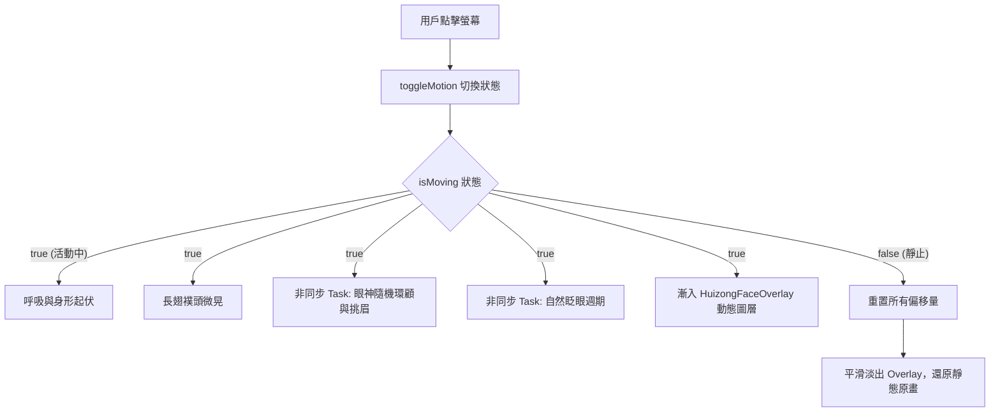

# 1003hw - 宋徽宗宮廷畫像與動態互動 App (SwiftUI)


本專案使用 **SwiftUI 原生繪圖技術（Path 與 Shape）**，細緻重現宋代藝術家皇帝——**宋徽宗趙佶**的經典宮廷坐像。除了高還原度的傳統工筆畫視覺風格外，專案更結合現代 Swift 結構化併發（Concurrency）與動畫修飾符，打造兼具古韻與生機的面部動態互動系統。

---

## 📖 目錄
- [專案簡介](#-專案簡介)
- [核心功能與亮點](#-核心功能與亮點)
- [視覺繪製解析 (SwiftUI Artistry)](#-視覺繪製解析-swiftui-artistry)
- [動態互動架構 (Motion & Concurrency)](#-動態互動架構-motion--concurrency)
- [專案架構](#-專案架構)
- [環境需求與執行方式](#-環境需求與執行方式)

---

## 🎨 專案簡介

在中國歷代帝王畫像中，宋徽宗以清瘦俊逸、儒雅貴氣著稱。本專案完全透過 SwiftUI 的幾何形狀組合與路徑繪製，重新詮釋這幅典雅名作：
- **宣紙底蘊**：選用高質感古典宣紙背景，重現古色古香的書畫質感。
- **神韻形貌**：從帝王緋紅圓領龍袍、宋代標誌性的展翅長翅襆頭，到微揚的劍眉、古典鳳眼與修長鬍鬚，皆由純程式碼精密繪製而成。
- **跨時空互動**：點擊畫面即可喚醒沉睡千年的徽宗，呈現呼吸起伏、眼神流轉、自然眨眼與長翅隨風輕曳的靈動效果。

---

## ✨ 核心功能與亮點

1. **純 SwiftUI 原生刻畫（Zero Vector Assets）**
   - 不仰賴向量繪圖軟體輸出的 SVG，全靠 `Path`、`Circle`、`Ellipse`、`Capsule`、`Rectangle` 等原生視圖疊加組合。
2. **生動有機的面部動態（Organic Facial Animation）**
   - **眼神靈動顧盼**：瞳孔帶有微小隨機位移與反光高光點，非機械式巡迴，神態自然。
   - **自然眨眼週期**：非同步排程模擬人類眨眼機制（急速閉合、短暫停留、輕柔復原）。
   - **情緒微表情（微挑眉）**：左右眉毛微不對稱挑動，展現帝王沉思神采。
   - **帝王氣色紅暈**：雙頰覆蓋柔和高斯模糊紅暈，隨均勻呼吸若隱若現。
3. **沉浸式觸控互動（Touch Interaction）**
   - 點擊螢幕任何位置即可平滑切換「動態活動中」與「靜態原畫」。
   - 底部設有宋代水墨質感的膠囊操作提示（Play / Pause 狀態切換）。
4. **非侵入式架構（Non-intrusive Architecture）**
   - 透過自訂 `HuizongMotionModifier` 與獨立的 `HuizongFaceOverlay` 實現動態層，不改動原始幾何繪製程式碼，靜態與動態切換時可 100% 無縫還原原始畫作。

---

## 🖌 視覺繪製解析 (SwiftUI Artistry)

| 部位 | 使用形狀 / 技術 | 繪製手法與設計細節 |
| :--- | :--- | :--- |
| **宣紙背景** | `Image("paper")` | 仿古宣紙肌理，搭配 `ignoresSafeArea()` 鋪滿全屏 |
| **帝王龍袍** | `Circle().trim(...)` | 半圓弧裁切搭配 `scaleEffect(y: 1.35)` 與古典緋紅色彩 (`#A62626`) |
| **內襯交領** | `Ellipse()` 雙層旋轉 | 左右各以 `-60°` 與 `+60°` 傾斜放置，呈現漢服經典交領右衽 |
| **長翅襆頭** | `Rectangle()` + `Path` | 水平延伸長條長翅，搭配上下兩個封閉 `Path` 拼組精緻宋代平頂官帽 |
| **面容輪廓** | `Capsule()` | 橢圓膠囊等比橫向延展，呈現宋代宮廷畫典型的長形鵝蛋臉 |
| **古典鳳眼** | 多重 `Ellipse()` 疊加 | 多組不同傾角眼白層次疊加，描繪出內勾外翹的古典單鳳眼韻味 |
| **微揚劍眉** | 雙段 `Capsule()` | 主眉身與眉尾分段傾斜，塑造英氣與內斂兼備的眉型 |
| **懸膽鼻** | `Path` + `StrokeStyle` | 平滑連線轉折與圓角端點（`.round` cap/join），細緻勾勒鼻樑與鼻翼 |
| **朱唇鬍髭** | `Path` 填色與線條描邊 | 上下唇峰細緻輪廓、深色唇縫，以及下巴與兩鬢的三綹微飄美髯 |

---

## 🧠 動態互動架構 (Motion & Concurrency)

動態效果由 `HuizongMotionModifier` 統籌管理，採用 Swift 現代 Concurrency 與宣告式動畫設計：



### 1. 呼吸與律動
- 藉由 `.scaleEffect` (1.03x) 與 `.offset(y: -12)` 配合 `.easeInOut(duration: 2.2).repeatForever(autoreverses: true)`，模擬沉穩均勻的腹式呼吸。
- 襆頭長翅以底部為錨點 (`anchor: .bottom`) 產生 `±1.8°` 的極慢速搖曳 (`duration: 3.2`)。

### 2. 眼神流轉與挑眉 (`Task` 異步調度)
- 透過 `.task(id: isMoving)` 建立隨機輪詢，每隔約 1.8 秒以 EaseInOut 動態產生 `eyeLookOffset`（瞳孔橫移）與 `eyebrowLift`（微揚或微蹙）。
- 左右眉毛採用微不對稱係數運算，擺脫機械式的呆板對稱感。

### 3. 生理級自然眨眼
- 獨立非同步計時器隨機延遲 2.2 ~ 3.5 秒觸發一次閉眼。
- 閉眼階段使用 `0.10s` 的快速 `.easeIn` 繪製柔和雙眼皮闔眼線條，停留 140 毫秒後以 `0.12s` 的 `.easeOut` 重新睜眼。

---

## 📁 專案架構

```text
.
├── 10.3 作業.xcodeproj         # Xcode 專案工程設定檔
├── 10.3 作業/
│   ├── MyApp.swift            # App 程式入口點 (@main)
│   ├── ContentView.swift      # 核心繪製代碼、動態修飾符與表情覆蓋圖層
│   └── Assets.xcassets/       # 圖片與色彩素材庫（含宣紙底圖 paper.jpeg）
└── README.md                  # 專案詳盡說明文件
```

---

## 🚀 環境需求與執行方式

### 開發環境
- **作業系統**：macOS Sonoma (14.0) 或更新版本
- **開發工具**：Xcode 15.0+
- **目標平台**：iOS 17.0+ / iPadOS 17.0+ / macOS 14.0+ (Designed for iPad)

### 執行步驟
1. 複製本儲存庫：
   ```bash
   git clone https://github.com/philix-felix/1003hw.git
   ```
2. 使用 Xcode 開啟專案：
   ```bash
   open "10.3 作業/10.3 作業.xcodeproj"
   ```
3. 選擇模擬器（如 iPhone 15 Pro 或 iPad Pro）並按下快捷鍵 `Cmd + R` 執行。
4. 亦可在 `ContentView.swift` 中直接點擊 Xcode Canvas 即時進行互動預覽。

---

## 👨‍💻 作者與版權
- **作者**：Felix Chang ([@philix-felix](https://github.com/philix-felix))
- **授權**：依學術研究與個人學習目的開放。
